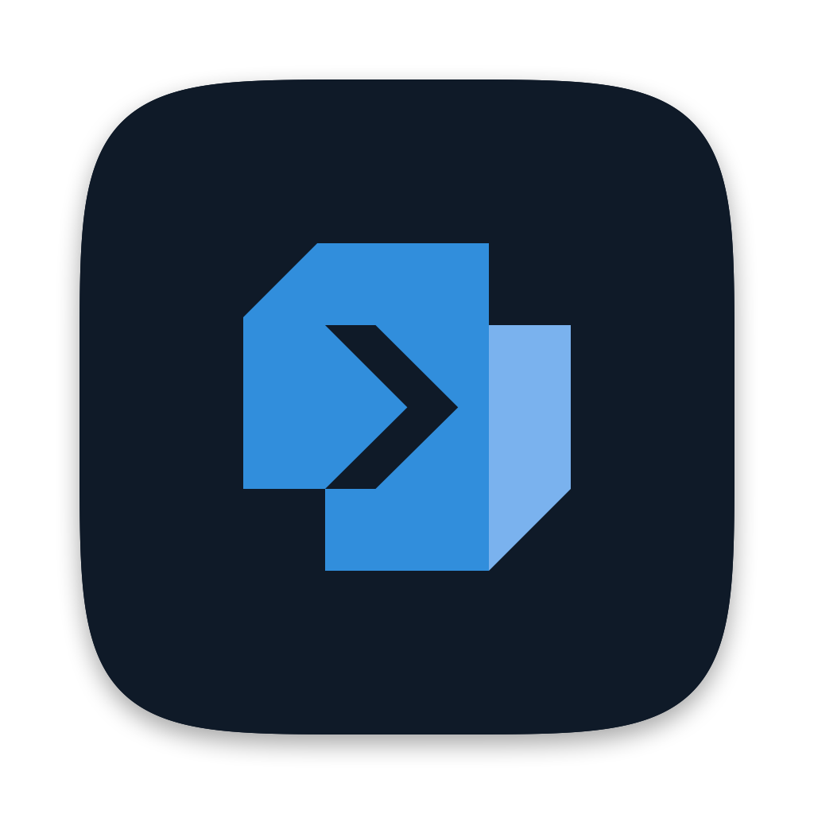

<p align="center">
  
</p>

<h1 align="center">Relay</h1>

<p align="center"><b>A fast, modern SSH connection manager and terminal, built on OpenSSH.</b></p>

Relay is a desktop app for people who live in SSH: a tree of your connections, a real terminal with
per-command blocks, tabs and split panes, and the everyday tools around SSH (encrypted backup, key
management, file browsing, port forwards) in one place. It ships with **`relay-ssh`**, a small command-line
companion that reads and writes the same data.

> **Status: early and macOS first.** Relay is being built in the open. The desktop app is developed
> and tested on macOS (Apple silicon). Windows and Linux builds, signed releases and installers are not
> done yet. See [Roadmap](#roadmap).

## Why another SSH client?

- **OpenSSH stays the SSH client.** Relay never reimplements the protocol. It generates standard
  OpenSSH config and runs your system `ssh`, `sftp` and `ssh-keygen`, so jump hosts, agents, hardware
  keys, passwords, passphrases and 2FA all keep working exactly as they do in a plain terminal.
- **No secrets are stored by default.** Relay leaves passwords and passphrases to OpenSSH unless you opt in. For password-only servers, you can optionally store the password in an age-encrypted vault on disk (`~/.config/relay-ssh/vault.age`), unlocked with your master password and auto-filled safely during authentication. A saved password is only ever sent to the host, user and port it was saved for, and it is not part of backups. You can view one again in the connection's settings, but only after entering the master password (every time, even with the vault unlocked). Key passphrases (delegated to the macOS Keychain and ssh-agent) and 2FA codes are never stored by Relay.
- **Your data is one human-readable file.** Connections live in `connections.toml`, which you can edit
  with any editor. Relay regenerates an OpenSSH include file from it, and the CLI and the app always
  agree.
- **The terminal is not in the way.** Terminal bytes flow from a real PTY to [xterm.js](https://xtermjs.org)
  untouched, with flow control. Go does no terminal emulation, which is what makes it fast with huge
  output (a 200 MB `cat` finishes in about 2.5 s with the UI staying responsive).

## Features

**Desktop app (Relay)**

- Connection tree with folders and subfolders, tags, search, jump hosts, agent forwarding and saved port
  forwards. Double-click a connection to open it. Drag connections and folders to reorganise (every move asks
  for confirmation first), drag a connection onto a terminal to split it, drag tabs to reorder them and
  panes by their header to rearrange them.
- Terminal with tabs, split panes, scrollback search, fonts and four themes (three dark, one light, or follow the system). With shell integration on,
  each command becomes a block with its directory, git branch, exit status and duration, started from the bottom of the pane, and a ⋯ menu
  on each block copies the command, its output, or both.
  Local zsh and bash are set up automatically; for a remote host you opt in (a button, or
  automatically per connection or for all of them, once the login has finished).
- **Snippets:** saved commands (`~/.config/relay-ssh/snippets.toml`) that you insert into, or run in, any terminal.
- **Tools:** health check with one-click fixes, passphrase-encrypted backup and restore, import from
  `~/.ssh/config`, key management (adopt a key into the vault; for a key with a passphrase, Relay asks once and
  hands it to the macOS Keychain and ssh-agent so ssh stops asking; Relay never stores it), and the **encrypted secret vault**
  for optional SSH password auto-fill with idle auto-lock.
- **Files:** browse, upload and download over `sftp`, reusing the login of the connection's terminal tab.
- **Port forwards:** add, stop and save local, remote and SOCKS forwards on a live connection, with a
  diagram of how each one works.
- **Remote Desktop (RDP):** connect to Windows servers in dedicated canvas tabs with WebAssembly IronRDP,
  TOFU host certificates, SSH jump host tunnels, and age vault password storage.

**Command line (`relay-ssh`)**

```
relay-ssh                    pick a connection and connect
relay-ssh <name>             connect to a saved profile
relay-ssh ls [--tree]        list profiles
relay-ssh add | edit | rm    manage profiles
relay-ssh cp <name>:/p ./l   copy files with scp
relay-ssh import             adopt hosts from ~/.ssh/config
relay-ssh backup | restore   encrypted archive of connections and keys
relay-ssh doctor [--fix]     check the installation
relay-ssh sync               regenerate ~/.ssh/relay-ssh.d/config
relay-ssh completion <shell> bash or zsh completions
```

`relay-ssh` builds an argv and replaces itself with `ssh`; it is not running while you are connected.

## Install and build

You need [Go](https://go.dev) 1.27+ and, for the desktop app, [Node.js](https://nodejs.org) 22 or newer and the
[Wails 3](https://v3.wails.io) CLI.

**CLI**

```bash
go install github.com/poppyszn/relay-ssh/cmd/relay-ssh@latest
# or, from a checkout:
make build            # produces ./relay-ssh
```

**Coming from `sssh`?** The command-line tool used to be called `sssh`. The first time `relay-ssh` or the app
starts it moves `~/.config/sssh` to `~/.config/relay-ssh` and `~/.ssh/sssh.d` to `~/.ssh/relay-ssh.d`, repoints the
managed block in `~/.ssh/config`, and regenerates the generated config, so your connections and keys carry
over. It never overwrites a `relay-ssh` folder that already exists, and the old `SSSH_HOME` and
`SSSH_BACKUP_PASSPHRASE` variables still work. You can delete the old `sssh` binary afterwards.

**Desktop app (macOS)**

```bash
go install github.com/wailsapp/wails/v3/cmd/wails3@v3.0.0
cd desktop
wails3 dev -config ./build/config.yml -port 9245     # run with live reload
```

To try it without touching your real SSH setup, point it at a throwaway home first:

```bash
RELAY_SSH_HOME=/tmp/relay-home wails3 dev -config ./build/config.yml -port 9245
```

`RELAY_SSH_HOME` redirects where Relay reads and writes its own files (`connections.toml`,
`~/.ssh/relay-ssh.d/`). A production build is `npm run build` in `desktop/frontend`, then `go build` in
`desktop/`.

## How it works

```
Relay window (webview)          Go backend                      Your machine
-----------------------         ---------------------------     -------------------------
xterm.js (WebGL)        <--->   PTY session (raw bytes)  <--->  ssh <profile>
IronRDP (WebAssembly)   <--->   Loopback gateway (bytes) <--->  rdp / ssh -L tunnel
connection tree UI      <--->   internal/core (shared)   <--->  connections.toml
tools, files, forwards          ssh / sftp / ssh-keygen         ~/.ssh/relay-ssh.d/config
```

- `connections.toml` is the single source of truth. Saving regenerates
  `~/.ssh/relay-ssh.d/config`, pulled in by one marked `Include` block in `~/.ssh/config`. Relay only writes
  inside `~/.ssh/relay-ssh.d/` and that block.
- Terminal bytes and RDP packets travel over loopback WebSockets guarded by random session tokens and exact
  Origin allow-lists. Relay relays RDP bytes directly but never decodes them.
- File transfers and live port forwards attach to the connection's terminal tab through OpenSSH
  connection sharing (`ControlMaster`), so they never need your credentials.
- Backups are a gzip tarball encrypted with [age](https://age-encryption.org) (scrypt passphrase). Relay
  never stores the passphrase.

## Remote Desktop (RDP)

Relay has embedded RDP client support in the desktop application alongside SSH. **It is experimental.** It connects to a real Windows server with NLA (Network Level Authentication), and has been run against an xrdp server in a container (TLS, login screen and desktop drawn correctly, keyboard, mouse, resizing). Clipboard, jump hosts and the vault's saved password are not yet proven. It is only in builds that include the client (below).

- **Building the client:** the remote desktop client is IronRDP's official browser client, built from the IronRDP commit pinned in `desktop/rdp-client/ironrdp.pin`. Run `make rdp-client` (needs `git`, `node`, `rustup` and `wasm-pack`) before building the app; without it the RDP tab says so instead of connecting.

- **Saved profiles:** Remote desktop connections are saved in `connections.toml` with `protocol = "rdp"`, an optional `domain`, and port defaulting to 3389. The `relay-ssh` CLI ignores RDP profiles so OpenSSH configuration remains clean.
- **Pure relay:** Relay relays RDP bytes directly between the server and an in-browser WebAssembly client ([IronRDP](https://github.com/Devolutions/IronRDP)) over a loopback WebSocket. Go does no RDP decoding or rendering.
- **TOFU host certificates:** Server TLS certificates are pinned on first use in `~/.config/relay-ssh/rdp_hosts.toml`. If a certificate fingerprint changes, Relay displays a clear security warning and requires explicit user confirmation.
- **Jump hosts:** RDP connections can tunnel through any saved SSH jump host via a local port forward (`ssh -L`), automatically torn down when the session closes.
- **Credentials:** Passwords can be stored encrypted in Relay's age vault (`~/.config/relay-ssh/vault.age`) or prompted in-memory per session. Relay never writes passwords to disk or logs unencrypted.
- **Clipboard & shortcuts:** the client synchronises the clipboard with the remote desktop, and a toolbar sends Ctrl+Alt+Delete. Keyboard shortcuts using `⌘` stay with Relay so window and tab controls always work.

## Example `connections.toml`

```toml
version = 1
folders = ["archive"]            # optional: folders that exist even when empty

[[profile]]
name = "web-1"
host = "10.0.0.5"
user = "deploy"
port = 2222
auth = "key"                     # agent | key | password
key = "id_ed25519"
folder = "prod/eu"
tags = ["web", "critical"]
jump = "bastion"                 # another saved profile
forward_agent = true

  [[profile.tunnel]]
  type = "local"                 # local | remote | dynamic
  listen = "8080"
  target = "localhost:80"

[[profile]]
name = "win-dc"
protocol = "rdp"
host = "10.0.0.12"
user = "Administrator"
domain = "CORP"
port = 3389
jump = "bastion"
```

## Roadmap

- [x] CLI: vault, generated OpenSSH config, backup, doctor, import
- [x] Desktop: connections, tabs, split panes, command blocks, search, themes
- [x] Desktop: tools (health, backup, import, keys), file browser, port forwards
- [ ] Windows (ConPTY, no connection sharing) and Linux builds
- [x] CI for the desktop app (macOS, on GitHub)
- [ ] Signed and notarized macOS releases, installers
- [ ] DevOps: environment tags with coloured tabs; AWS SSM (SSH over SSM and EC2 import); Kubernetes contexts
  pinned per tab with port forwards; a host-key manager for `known_hosts`
- [x] Encrypted vault for opt-in SSH and RDP password auto-fill
- [ ] Embedded Remote Desktop (RDP) tabs with WebAssembly IronRDP, TOFU cert pinning and SSH jump tunnels (works against Windows with NLA; clipboard, jump hosts and saved passwords still to be proven)
- [x] Per-block menu: copy command, output, or both
- [x] Light theme (Daylight) and System, which follows the OS
- [x] Block header: directory and git branch on every block
- [x] Snippets: saved commands to insert or run in any terminal

## Contributing

Contributions are welcome. Please read [CONTRIBUTING.md](CONTRIBUTING.md) first; it explains the project's
principles, the checks to run (`make check`, `make desktop-check`) and the code budget the CLI keeps.
Security issues: see [SECURITY.md](SECURITY.md).

## License

[MIT](LICENSE) © 2026 Precious Okpor. Third-party software and the bundled fonts keep their own licenses;
see [THIRD_PARTY_NOTICES.md](THIRD_PARTY_NOTICES.md).
